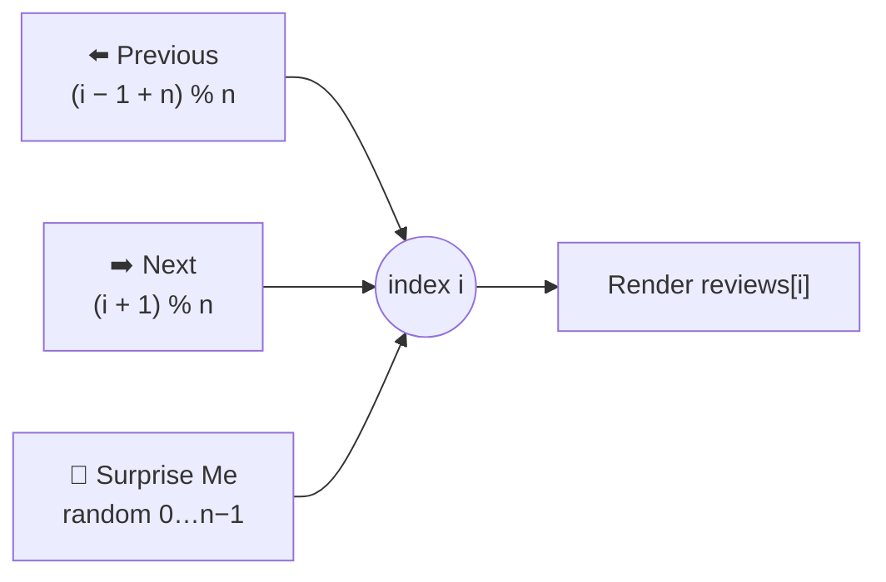

<div align="center">

# 💬 Testimonial Slider

**A clean, circular testimonial carousel in React — step through reviews with arrows or hit "Surprise Me" for a random one.**

[](https://testimonial-slider-topaz.vercel.app)


[Features](#-features) · [How it works](#-how-it-works) · [Getting Started](#-getting-started)

</div>

---

## ✨ Features

- 👤 **Testimonial card** — photo, name, job title and quote
- ⬅️➡️ **Previous / Next** arrows that wrap around endlessly
- 🎲 **Surprise Me** jumps to a random testimonial
- 🧩 Data-driven — add reviews in one file

## 🔄 How it works



Modulo arithmetic keeps the slider **circular** — going past the last review returns to the first, and vice versa.

## 🚀 Getting Started

```bash
git clone https://github.com/Shariq2003/Testimonial_Slider.git
cd Testimonial_Slider
npm install
npm start            # http://localhost:3000
```

<details>
<summary><b>✏️ Add a testimonial</b></summary>

Append to the array in [`src/data.js`](src/data.js):

```js
{
  id: 6,
  name: "Jane Doe",
  job: "Product Designer",
  image: "https://…/jane.jpg",
  text: "Working with this team was a fantastic experience…",
}
```

</details>

<details>
<summary><b>📁 Project structure</b></summary>

```text
src/
├── components/Testimonials.jsx   # slider logic & UI
├── data.js                       # reviews
└── App.js
```

</details>

---

<div align="center">

Built by **[Shariq](https://github.com/Shariq2003)** · [LinkedIn](https://www.linkedin.com/in/shariq-sd)

⭐ If you like this project, consider giving it a star!

</div>
